<div align="center">
  
</div>

<div align="center">
  <a href="https://github.com/devcristianlopez">
    
  </a>
</div>

<p align="center">
  
  
  
  
  
</p>

<div align="center">
  
</div>

```console
┌──(devcristianlopez㉿github)-[~]
└─$ whoami
> Backend Developer & Software Architect · AI Orchestration

└─$ cat mission.txt
"Construyo backend, automatizo con IA y enseño lo que aprendo."
```

<div align="center">
  
</div>

<h2 align="center">⟨ 01 ⟩ · SYSTEM.PROFILE</h2>

> Desarrollador Backend y Arquitecto de Software con **8+ años** en Python, Django y Odoo. Diseño soluciones con IA aplicada (agentes, LLMs, RAG) y llevo **4+ años** como instructor técnico en cloud, datos y DevOps.
>
> Mi perfil, pero como código.

```python
from dataclasses import dataclass
from typing import ClassVar


@dataclass(slots=True)
class Developer:
    """Perfil vivo: identidad, stack, trayectoria y proyectos."""

    # ── identidad ──────────────────────────────────────────────────────────
    username: str = "devcristianlopez"
    name: str = "Cristian López"
    role: str = "Backend Developer & Software Architect"
    focus: str = "Python · Django · Odoo · AI Orchestration"
    location: str = "Valparaíso, Chile"
    email: str = "cristianlopezvalpo@gmail.com"

    # ── links ──────────────────────────────────────────────────────────────
    web: str = "https://lemoria.org/"
    linkedin: str = "https://linkedin.com/in/cristianl0pez"
    github: str = "https://github.com/devcristianlopez"

    # ── trayectoria ────────────────────────────────────────────────────────
    years_experience: int = 8
    years_teaching: int = 4

    # ── stack ──────────────────────────────────────────────────────────────
    languages: ClassVar[tuple[str, ...]] = ("Python", "TypeScript", "JavaScript", "SQL", "Bash")
    backend: ClassVar[tuple[str, ...]] = ("Django", "FastAPI", "Flask", "Odoo", "REST APIs")
    frontend: ClassVar[tuple[str, ...]] = ("Vue.js", "React", "Astro", "Tailwind CSS")
    data: ClassVar[tuple[str, ...]] = ("PostgreSQL", "MySQL", "SQL Server", "Redis", "Pandas")
    devops: ClassVar[tuple[str, ...]] = ("Docker", "Nginx", "Linux", "CI/CD", "DigitalOcean")
    ai: ClassVar[tuple[str, ...]] = ("Agents", "LLMs", "RAG", "Prompt Engineering", "MCP")

    # ── proyectos ──────────────────────────────────────────────────────────
    projects: ClassVar[dict[str, str]] = {
        "lemoria":               "AI memory & orchestration OS · 8 agents · persistent memory",
        "core-odoo":             "Self-hosted Odoo 20 software factory · Git envs & observability",
        "livebridge":            "TikTok LIVE SDK for Python · custom Webcast protocol",
        "manel":                 "Security health monitor for dev environments",
        "guardian-live-monitor": "OpenCV + FastAPI + WebSockets live surveillance",
        "boilerplate-django":    "Django + PostgreSQL + Docker, production ready",
        "coffe-code":            "PWA to brew the perfect coffee ☕",
    }

    # ── estado actual ──────────────────────────────────────────────────────
    currently: ClassVar[tuple[str, ...]] = (
        "Building Lemoria",
        "Consulting & AI development at Lanedu",
        "Teaching AI, cloud & data",
    )
    open_to: str = "freelance · consultoría · docencia · open source"
    coffee_level: int = 99  # ☕☕☕

    def __str__(self) -> str:
        return f"{self.name} · {self.role} · {self.location}"

    def greet(self) -> str:
        return f"Hey, soy {self.name}. Construyo backend, automatizo con IA y enseño lo que aprendo."


if __name__ == "__main__":
    me = Developer()
    print(me)
    print(me.greet())
```

<div align="center">
  
</div>

<h2 align="center">⟨ 02 ⟩ · TECH.ARSENAL</h2>

<h3 align="center">LANGUAGES</h3>
<p align="center">
  
  
  
  
  
</p>

<h3 align="center">BACKEND</h3>
<p align="center">
  
  
  
  
  
</p>

<h3 align="center">FRONTEND</h3>
<p align="center">
  
  
  
  
</p>

<h3 align="center">DATA · DEVOPS · AI</h3>
<p align="center">
  
  
  
  
  
  
  
  
  
</p>

<div align="center">
  
</div>

<h2 align="center">⟨ 03 ⟩ · FEATURED.PROJECTS</h2>

| ▸ PROYECTO | DESCRIPCIÓN | STACK | |
| :--- | :--- | :--- | :---: |
| **[lemoria](https://github.com/devcristianlopez/lemoria)** | Sistema Operativo de Memoria y Orquestación para Desarrollo con IA | `Python` `Agents` `MCP` |  |
| **[core-odoo](https://github.com/devcristianlopez/core-odoo)** | Fábrica de software self-hosted sobre Odoo 20: entornos Git, módulos, frontends y observabilidad | `TypeScript` `Odoo` `Docker` |  |

<details>
<summary><b>▸ VER TODOS LOS REPOSITORIOS</b></summary>
<br/>

- **[livebridge](https://github.com/devcristianlopez/livebridge)** — SDK Python para TikTok LIVE con protocolo Webcast propio · `Python`
- **[manel](https://github.com/devcristianlopez/manel)** — Security Health Monitor para entornos de desarrollo · `TypeScript`
- **[guardian-live-monitor](https://github.com/devcristianlopez/guardian-live-monitor)** — Video, movimiento y alertas en tiempo real · `Python` `OpenCV`
- **[boilerplate-django](https://github.com/devcristianlopez/boilerplate-django)** — Django + PostgreSQL + Docker listo para producción · `Python`
- **[coffe-code](https://github.com/devcristianlopez/coffe-code)** — PWA para preparar el café perfecto ☕ · `TypeScript`
- **[chileonline](https://github.com/devcristianlopez/chileonline)** — Noticias de Chile estilo notas de parche MMORPG · `Astro`
- **[wardogs-chile-bot](https://github.com/devcristianlopez/wardogs-chile-bot)** — Discord bot + plataforma competitiva · `Python`
- **[falcon-control-hub](https://github.com/devcristianlopez/falcon-control-hub)** — Control hub · `Python`
- **[nomicon](https://github.com/devcristianlopez/nomicon)** — Compendios del lenguaje tecnológico
- **[cursoia](https://github.com/devcristianlopez/cursoia)** — Curso de Desarrollo con IA: OpenCode y Agentes · `HTML`
- **[lanedu](https://github.com/devcristianlopez/lanedu)** — Consultoría tecnológica y cumplimiento digital · `HTML`
- **[config](https://github.com/devcristianlopez/config)** — Configuración portable de Omarchy e infraestructura · `QML`
- **[skills-opencode](https://github.com/devcristianlopez/skills-opencode)** — Skills de Python y Django para OpenCode

</details>

<div align="center">
  
</div>

<h2 align="center">⟨ 04 ⟩ · SYSTEM.METRICS</h2>

<div align="center">
  
</div>

<div align="center">
  
  
</div>

<div align="center">
  
</div>

<div align="center">
  
  
  
</div>

<div align="center">
  <!-- La serpiente aparece cuando corre .github/workflows/snake.yml y se crea la rama `output` -->
  <picture>
    <source media="(prefers-color-scheme: dark)" srcset="https://raw.githubusercontent.com/devcristianlopez/devcristianlopez/output/github-contribution-grid-snake-dark.svg"/>
    <source media="(prefers-color-scheme: light)" srcset="https://raw.githubusercontent.com/devcristianlopez/devcristianlopez/output/github-contribution-grid-snake.svg"/>
    
  </picture>
</div>

<div align="center">
  
</div>

<h2 align="center">⟨ 05 ⟩ · CONNECT</h2>

<div align="center">
  <a href="https://github.com/devcristianlopez"></a>
  <a href="https://linkedin.com/in/cristianl0pez"></a>
  <a href="https://lemoria.org/"></a>
  <a href="mailto:cristianlopezvalpo@gmail.com"></a>
</div>

<br/>

<div align="center">
  
</div>

<div align="center">
  <sub><b>「 Primero lo haces funcionar. Después lo haces rápido. Después lo haces bonito. 」</b></sub>
  <br/><br/>
  
</div>
